## Умови проведення вимірювань

Для забезпечення однакових умов під час аудиту всі вимірювання проводяться з використанням таких налаштувань:

- **Браузер:** Google Chrome (версія 150.0.7871.125).
- **Режим браузера:** інкогніто.
- **CPU throttling:** 4× slowdown.
- **Network throttling:** Fast 4G.
- **Версія застосунку:** production-збірка (`npm run build` та `npm run preview`).

## Користувацькі сценарії для аудиту

Для перевірки продуктивності вебзастосунку обрано п'ять користувацьких сценаріїв, які охоплюють основні функції каталогу репетиторів.

### Сценарій 1. Завантаження сторінки

Відкриття каталогу репетиторів та завантаження основного вмісту сторінки.

| Метрика | Значення 1 | Значення 2 | Значення 3 | Медіана | Після виправлень |
|---|---:|---:|---:|---:|---:|
| LCP | 3.95 s | 3.70 s | 4.02 s | 3.95 s | 1.77 s |
| CLS | 0.19 | 0.19 | 0.19 | 0.19 | 0.32 |
| Обсяг завантажених даних | 23.0 MB | 23.0 MB | 23.0 MB | 23.0 MB | 2 MB |
| Сума Long Tasks | 4342.32 ms | 4081.48 ms | 4403.24 ms | 4342.32 ms (≈ 4.34 s) | 1801.84 ms |

### Сценарій 2. Пошук репетитора

Введення тексту в поле пошуку та оновлення списку відповідно до пошукового запиту.

| Метрика | Значення 1 | Значення 2 | Значення 3 | Медіана | Після виправлень |
|---|---:|---:|---:|---:|---:|
| Тривалість взаємодії | 2857 ms | 2480 ms | 2763 ms | 2763 ms | 141 ms |
| Сума Long Tasks | 4301.99 ms | 3727.92 ms | 3662.70 ms | 3727.92 ms | 502.84 ms |

### Сценарій 3. Фільтрація та сортування

Застосування фільтрів і зміна порядку сортування репетиторів. Кожна дія перевіряється окремо.

#### Фільтрація

| Метрика | Значення 1 | Значення 2 | Значення 3 | Медіана |
|---|---:|---:|---:|---:|
| Тривалість взаємодії | 145 ms | 112 ms | 179 ms | 145 ms |
| Сума Long Tasks | 185.42 ms | 142.31 ms | 219.67 ms | 185.42 ms |

#### Сортування

| Метрика | Значення 1 | Значення 2 | Значення 3 | Медіана |
|---|---:|---:|---:|---:|
| Тривалість взаємодії | 85 ms | 79 ms | 123 ms | 85 ms |
| Сума Long Tasks | 466.40 ms | 479.02 ms | 500.16 ms | 479.02 ms |

Метрики: тривалість взаємодії, сума Long Tasks.

### Сценарій 4. Робота з обраними

Додавання репетитора до обраного та видалення його з цього списку.

#### Додавання до обраного

| Метрика | Значення 1 | Значення 2 | Значення 3 | Медіана |
|---|---:|---:|---:|---:|
| Тривалість взаємодії | 195 ms | 195 ms | 195 ms | 195 ms |
| Сума Long Tasks | 270.58 ms | 258.48 ms | 257.59 ms | 258.48 ms |

#### Видалення з обраного

| Метрика | Значення 1 | Значення 2 | Значення 3 | Медіана |
|---|---:|---:|---:|---:|
| Тривалість взаємодії | 195 ms | 195 ms | 195 ms | 195 ms |
| Сума Long Tasks | 266.13 ms | 268.34 ms | 270.36 ms | 268.34 ms |

### Сценарій 5. Перегляд картки репетитора

Вимірюємо відкриття картки репетитора.

| Метрика | Значення 1 | Значення 2 | Значення 3 | Медіана | Після виправлень |
|---|---:|---:|---:|---:|---:|
| Тривалість взаємодії | 429 ms | 279 ms | 229 ms | 279 ms | 112 ms |
| Сума Long Tasks | 528.01 ms | 338.53 ms | 297.34 ms | 338.53 ms | 117.06 ms |

Для кожного сценарію буде проведено щонайменше три вимірювання. До базової лінії буде внесено меданне значення отриманих результатів.


## Аналіз продуктивності за допомогою Lighthouse

Для додаткового дослідження продуктивності початкового завантаження сторінки було проведено аудит за допомогою Lighthouse у Chrome DevTools.

**Умови перевірки:**

- **Режим:** Navigation.
- **Пристрій:** Desktop.
- **Категорія:** Performance.
- **Середовище:** production-збірка застосунку (`npm run preview`).

#### Результати основних метрик

Під час перевірки отримано такі показники:

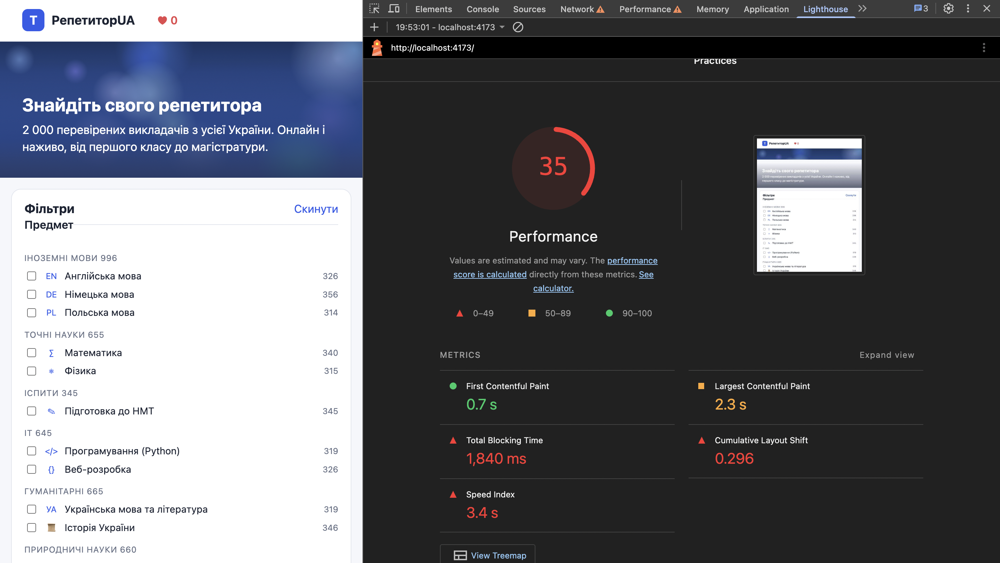

Найбільші показники TBT та CLS. TBT становить 1840 мс, що вказує на значне блокування головного потоку під час завантаження сторінки. CLS дорівнює 0,296, тобто під час завантаження відбуваються помітні зміщення елементів інтерфейсу.


## Проблема 1. Велика кількість DOM-елементів

**Симптом:**

Під час початкового завантаження сторінки браузеру потрібно обробити велику кількість елементів каталогу. Усі картки репетиторів одразу відображаються на сторінці, навіть якщо користувач ще не переглядав більшу частину списку.

**Гіпотеза:**

Причиною додаткового навантаження на браузер може бути відсутність поступового завантаження карток або обмеження їхньої кількості в DOM. Оскільки каталог містить близько 2000 репетиторів, браузеру доводиться створювати та обробляти велику кількість HTML-елементів уже під час початкового завантаження сторінки. Це може збільшувати обсяг роботи браузера під час побудови DOM, обчислення стилів і відображення сторінки.

**Перевірка та доведення гіпотези:**

#### 1. Аналіз розміру DOM за допомогою Lighthouse

Для перевірки було запущено Lighthouse у Chrome DevTools для production-версії застосунку. У результатах аудиту розгорнуто рекомендацію `Optimize DOM size`.

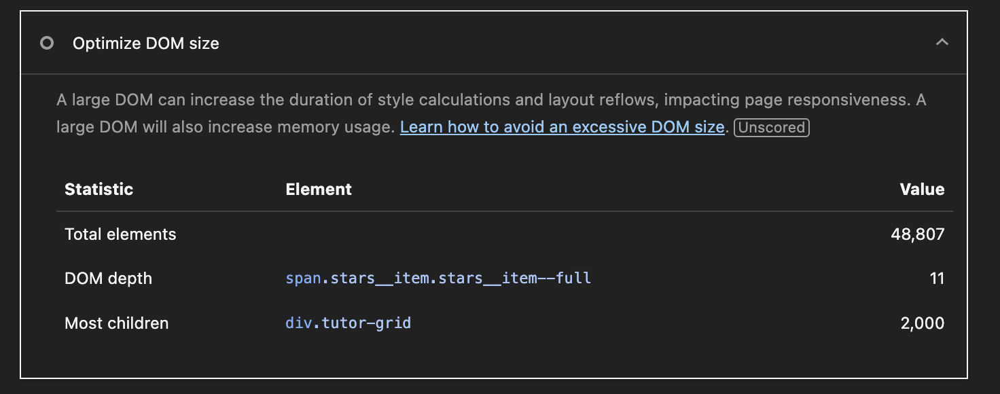

На скриншоті видно такі результати:

- **Total elements - 48 807:** загальна кількість DOM-елементів на сторінці.
- **DOM depth - 11:** максимальна глибина вкладеності DOM-дерева.
- **Most children - 2 000:** найбільшу кількість дочірніх елементів має контейнер `div.tutor-grid`.

Ці показники свідчать про значний розмір DOM-дерева. Особливо важливим є результат для `div.tutor-grid`, оскільки саме цей контейнер містить картки репетиторів.

#### 2. Перевірка кількості карток у DOM через Console

Щоб перевірити, скільки саме карток репетиторів одночасно присутні на сторінці, у Console виконано команду:

```js
document.querySelectorAll('.tutor-grid .tutor-card').length
```

У результаті отримано значення **2000**.

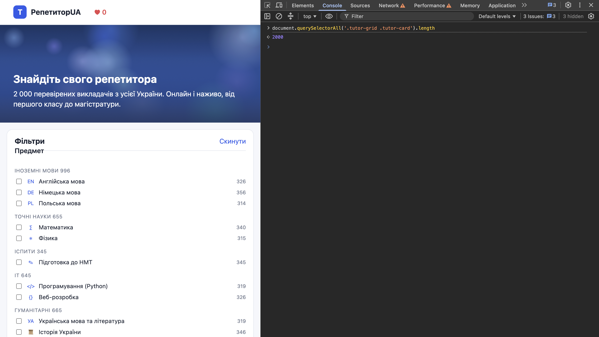

Це підтверджує, що всі картки каталогу одночасно присутні в DOM. Тобто список не обмежений невеликою кількістю видимих карток, а браузер обробляє майже весь каталог одразу.

**Висновок:**

Проведені перевірки підтвердили, що сторінка має великий DOM - 48 807 елементів, а контейнер каталогу містить близько 2000 дочірніх елементів. Додаткова перевірка через Console показала, що 2000 карток репетиторів одночасно присутні в DOM.
Отже, браузер змушений обробляти весь каталог уже під час початкового завантаження, незалежно від того, яку частину списку переглядає користувач.


## Проблема 2. Великий розмір зображень та можливе відсутнє відкладене завантаження

**Симптом:**

Під час початкового завантаження сторінки браузер завантажує зображення значного розміру. Головне зображення `hero.png` займає приблизно 1,3 МБ, а фотографії репетиторів — близько 600 КБ кожна. Усі вони збережені у форматі PNG, що збільшує обсяг даних, які потрібно передати мережею.

**Гіпотеза:**

Причиною збільшеного обсягу завантажуваних даних може бути недостатня оптимізація зображень. Також необхідно перевірити, чи використовується відкладене завантаження фотографій репетиторів. Якщо воно не налаштоване, браузер може завантажувати зображення карток, які ще не потрапили в область перегляду користувача.

**Перевірка та доведення гіпотези:**

**1. Аналіз розміру зображень у Network.**

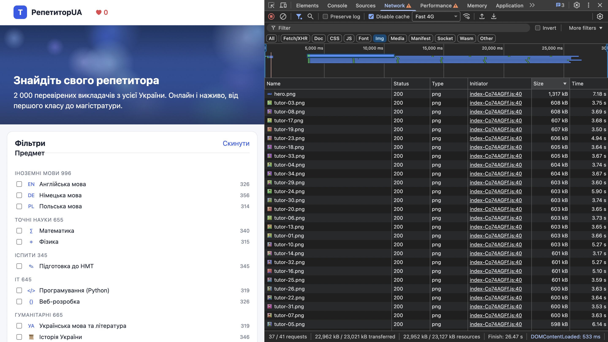

На скриншоті видно, що головне зображення `hero.png` займає приблизно 1,3 МБ, а фотографії репетиторів — близько 600 КБ кожна. За назвами файлів також можна визначити, що вони мають формат PNG.
Це підтверджує, що сторінка використовує зображення значного розміру, які збільшують обсяг завантажуваних ресурсів.

**2. Перевірка відкладеного завантаження фотографій у коді.**

Для перевірки відкрито компонент `src/components/TutorCard.jsx`, у якому відображається фотографія репетитора.

У коді знайдено такий елемент:

```jsx

```

Для зображення не задано атрибут `loading="lazy"`, тому відкладене завантаження на рівні HTML для фотографій карток не налаштоване.

**Висновок:**

Перевірка виявила дві потенційні причини збільшеного обсягу завантажуваних даних: значний розмір PNG-зображень та відсутність налаштованого відкладеного завантаження фотографій карток репетиторів.


## Проблема 3. Надмірні витрати часу на Layout

**Симптом:**

Під час початкового завантаження сторінки виникає довга задача тривалістю 2940,9 мс. Значну частину часу займає операція `Layout` — 1534,3 мс Self time (50,8%).

**Гіпотеза:**

Однією з причин повільного початкового завантаження можуть бути часті перерахунки макета сторінки. Додаткове навантаження може створювати функція `Qd`, яка під час початкового рендерингу перевіряє висоту описів карток. Для цього вона змінює CSS-класи та зчитує розміри елементів. Чергування зміни стилів і зчитування геометричних властивостей може змушувати браузер повторно обчислювати макет сторінки.

**Перевірка та доведення гіпотези:**

**1. Перевірка тривалості початкового завантаження.**

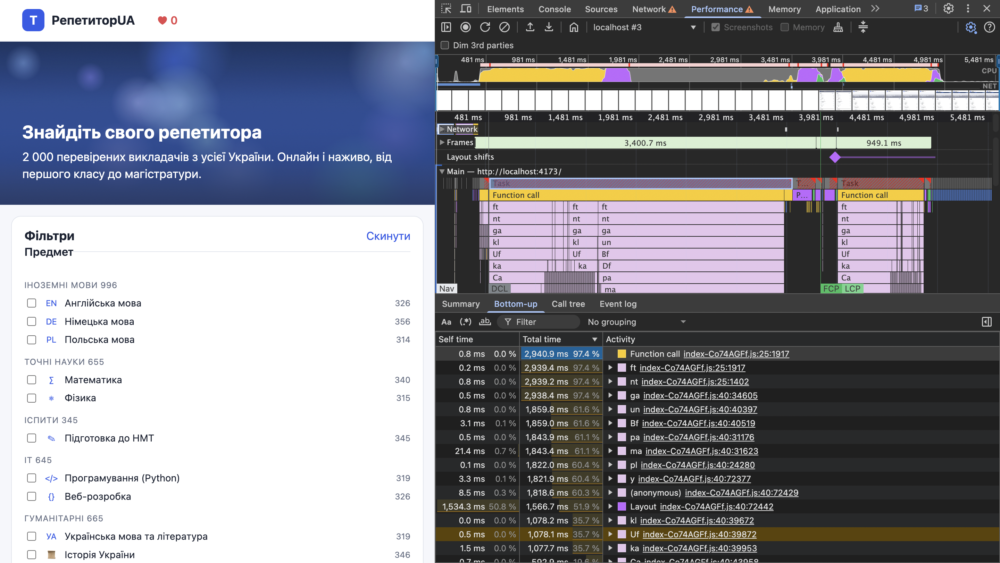

На скриншоті видно довгу задачу тривалістю 2940,9 мс, що свідчить про значне навантаження на основний потік браузера під час початкового завантаження.

**2. Визначення витрат часу на Layout.**

У вкладці Bottom-up знайдено операцію `Layout`. Її Self time становить 1534,3 мс (50,8%). Отже, більше половини часу вибраної довгої задачі припадає безпосередньо на перерахунок макета сторінки.


**3. Перевірка за допомогою Lighthouse.**

У звіті Lighthouse виявлено пункт `Forced reflow`. У ньому зазначено загальний час примусового перерахунку макета — 1713 мс. Також у звіті вказано відповідний фрагмент JavaScript (`index-Co74AGFf.js:40`).

Цей результат додатково підтверджує наявність примусових перерахунків макета під час роботи сторінки.

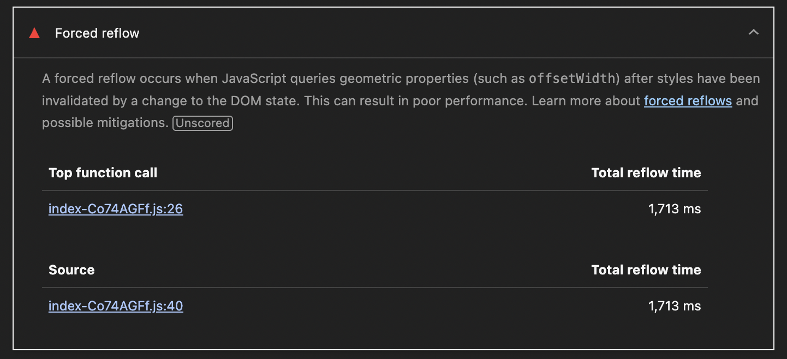

**4. Перевірка операцій, які можуть спричиняти перерахунок макета.**

У Sources знайдено функцію `Qd`, реалізацію якої показано на скриншоті.

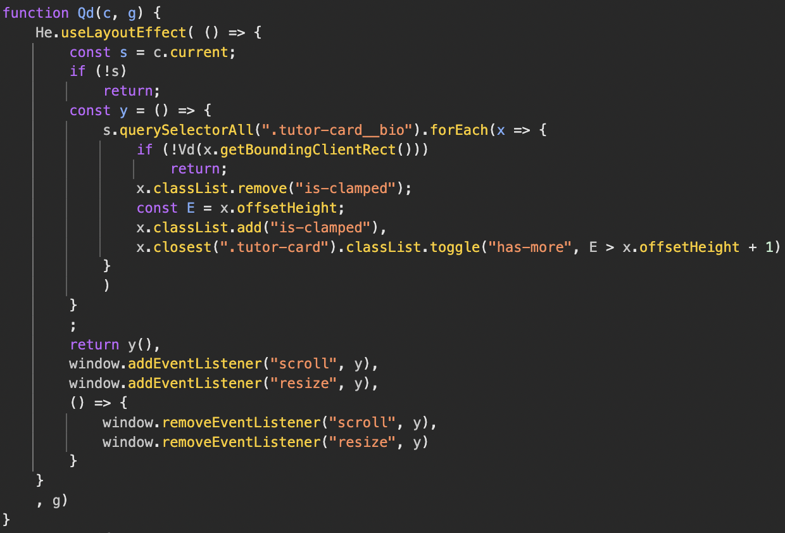

Під час виконання функція:
- знаходить елементи `.tutor-card__bio`;
- вимірює їхні розміри за допомогою `getBoundingClientRect()` та `offsetHeight`;
- тимчасово прибирає та повертає клас `is-clamped`;
- змінює клас `has-more` залежно від висоти опису.

Зчитування геометричних властивостей після зміни CSS-класів може змушувати браузер синхронно перераховувати макет.


**Висновок:**

Проведений аналіз показав, що операція `Layout` займає 1534,3 мс Self time (50,8%) вибраної довгої задачі. Крім того, Lighthouse виявив `Forced reflow` із загальним часом 1713 мс. Дослідження вихідного коду також виявило функцію `Qd`, яка змінює CSS-класи та повторно вимірює розміри елементів.
Отримані результати підтримують гіпотезу про те, що операції вимірювання елементів у функції `Qd` можуть спричиняти додаткові перерахунки макета та збільшувати навантаження на браузер.


## Проблема 4. Повторне обчислення рейтингу репетиторів під час пошуку

**Симптом:**

Під час введення тексту в поле пошуку виникає значна затримка оновлення списку репетиторів. За результатами вимірювань медіана затримки взаємодії становить 2763 мс. Аналіз Performance також показав тривале виконання обробки події `keyup`.

**Гіпотеза:**

Однією з причин повільного пошуку може бути повторне обчислення рейтингу репетиторів під час сортування результатів за рекомендаціями. Рейтинг розраховується на основі відгуків, зокрема їхніх оцінок та давності. Якщо ці обчислення виконуються повторно для кожного порівняння під час сортування, це може створювати додаткове навантаження на JavaScript, навіть якщо рейтинг репетитора не змінюється.

**Перевірка та доведення гіпотези:**

**1. Аналіз Performance під час пошуку.**

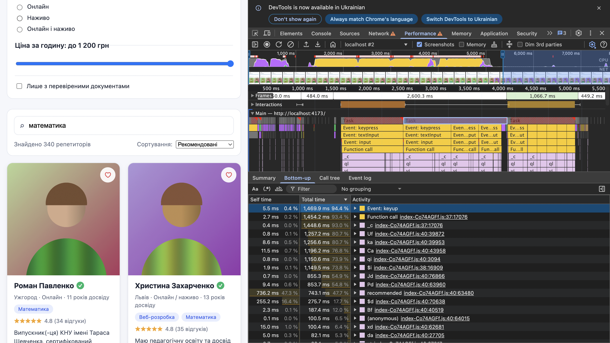

У Chrome DevTools Performance було проаналізовано процес пошуку репетиторів за запитом «математика». Під час введення пошукового запиту у вкладці Bottom-up виявлено функцію `recommended`, яка займає 736,2 мс Self time (47,3%) від часу вибраної події.
Це свідчить про те, що значна частина часу обробки введення пошукового запиту витрачається на сортування репетиторів за рекомендаціями.

**2. Перевірка логіки сортування.**

У вихідному коді знайдено функцію `Pd`, яка формує список репетиторів: спочатку застосовує фільтрацію за параметрами, потім пошуковим запитом, а після цього сортує отриманий список.

Для сортування за рекомендаціями використовується компаратор `recommended`, який викликає функцію `Ha` для двох репетиторів та порівнює отримані рейтинги.

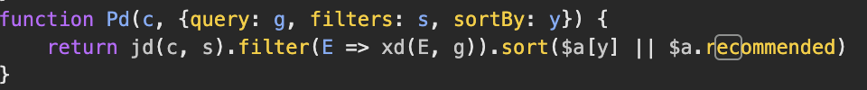

**3. Дослідження розрахунку рейтингу.**

Під час перевірки функції `Ha` виявлено, що вона викликає функцію `ec`, яка обчислює зважений середній рейтинг репетитора на основі його відгуків. Функція `ec` перебирає всі відгуки, перетворює дати, розраховує вагу кожного відгуку залежно від його давності та визначає підсумкову оцінку. Оскільки `Ha` викликається всередині компаратора `recommended`, ці розрахунки можуть повторюватися багато разів під час сортування одного й того самого списку репетиторів.

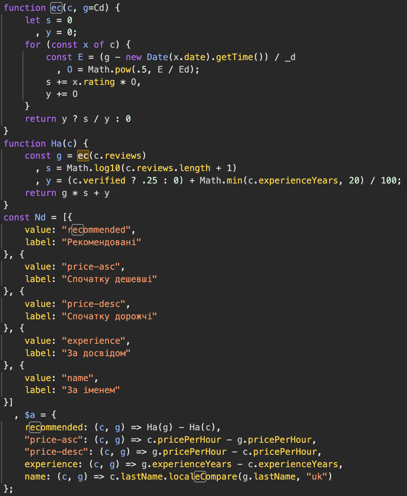

**Висновок:**

Аналіз Performance показав, що функція `recommended` займає 736,2 мс Self time (47,3%) під час обробки пошукового запиту. Дослідження вихідного коду виявило, що під час сортування за рекомендаціями рейтинг репетиторів повторно обчислюється на основі їхніх відгуків.


## Проблема 5. Повторне обчислення рейтингу репетиторів під час відкриття картки

**Симптом:**

Під час відкриття картки репетитора спостерігається затримка відображення. За результатами вимірювань медіана затримки взаємодії становить 279 мс. Аналіз Performance також показав значний час виконання функцій, пов'язаних із сортуванням каталогу та розрахунком рейтингу.

**Гіпотеза:**

Однією з причин затримки відкриття картки може бути повторне обчислення рейтингу репетиторів під час рендерингу каталогу. При відкритті картки змінюється стан вибраного репетитора, що викликає повторний рендер компонента. Під час нього знову виконується сортування каталогу за рекомендаціями, яке передбачає розрахунок рейтингів на основі відгуків. Якщо ці обчислення повторюються, хоча дані репетиторів не змінюються, це може створювати додаткове навантаження на JavaScript та збільшувати затримку взаємодії.

**Перевірка та доведення гіпотези:**

**1. Аналіз Performance під час відкриття картки.**

У Chrome DevTools Performance було проаналізовано обробку натискання кнопки відкриття картки репетитора. У вкладці Bottom-up виявлено функцію `ec`, яка займає 496,3 мс Self time. У Call tree також простежується ланцюжок викликів від обробки події до функції розрахунку рейтингу.

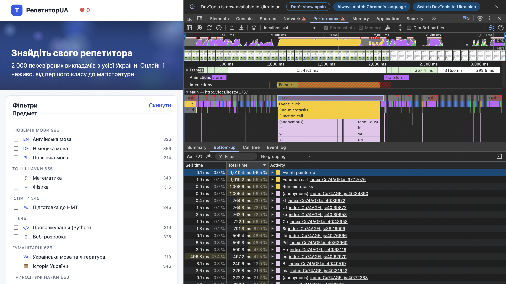

**2. Перевірка повторного виклику сортування.**

У вихідному коді компонента `Jd` виявлено виклик функції `Pd` безпосередньо під час рендерингу компонента. Відкриття картки змінює стан вибраного репетитора, що викликає повторний рендер `Jd`. Під час нього функція `Pd` знову виконує фільтрацію та сортування каталогу, навіть якщо пошуковий запит, фільтри та спосіб сортування не змінюються.

**3. Дослідження логіки розрахунку рейтингу.**

Під час перевірки функцій сортування виявлено, що компаратор `recommended` викликає функцію `Ha` для двох репетиторів, щоб порівняти їхні рейтинги. Функція `Ha`, у свою чергу, викликає `ec`, яка перебирає відгуки, перетворює дати, обчислює вагу кожного відгуку залежно від його давності та визначає зважений середній рейтинг. Таким чином, під час повторного сортування каталогу ці обчислення виконуються знову, навіть якщо рейтинги репетиторів не змінилися.

**Висновок:**

Аналіз Performance показав значний час виконання функції `ec` під час відкриття картки репетитора. Дослідження вихідного коду виявило, що зміна стану вибраного репетитора викликає повторний рендер компонента `Jd`, під час якого знову виконується сортування каталогу за рекомендаціями та перерахунок рейтингів на основі відгуків.


## Виправлення проблеми 1. Зменшення кількості DOM-елементів

**Обране рішення:**

Для усунення виявленої проблеми було вирішено реалізувати пагінацію каталогу репетиторів. Замість одночасного відображення всіх 2000 карток список було розділено на сторінки по 20 карток.

**Реалізація:**

Для реалізації пагінації в компоненті `App.jsx` було додано стан `currentPage`, який зберігає номер поточної сторінки.
Кількість сторінок визначається залежно від кількості знайдених репетиторів, а метод `slice()` використовується для отримання лише тих 20 карток, які потрібно відобразити на поточній сторінці.
Також було додано кнопки «Попередня» та «Наступна» для переходу між сторінками. Під час зміни пошукового запиту, фільтрів або сортування поточна сторінка скидається на першу.

**Перевірка результату:**

Після внесення змін було повторно запущено аудит Lighthouse для production-версії застосунку та перевірено кількість карток у DOM за допомогою Console.

1. **Перевірка кількості карток у DOM**

Для перевірки виконано команду:

```js
document.querySelectorAll('.tutor-grid .tutor-card').length
```

У результаті отримано значення **20**. Це підтверджує, що одночасно в DOM відображаються лише картки поточної сторінки, а не весь каталог.

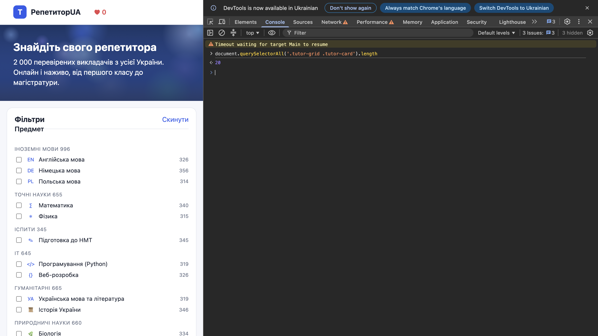

2. **Повторний аналіз розміру DOM за допомогою Lighthouse**

Після реалізації пагінації повторно перевірено рекомендацію `Optimize DOM size`.

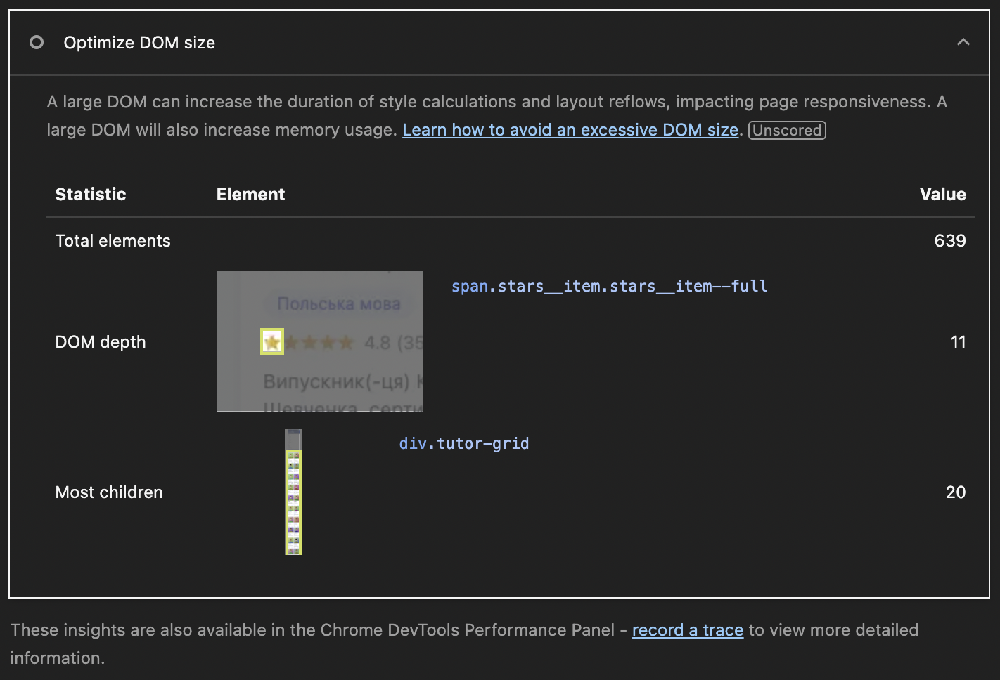

Отримано такі результати:

- **Total elements — 639:** загальна кількість DOM-елементів на сторінці.
- **DOM depth — 11:** максимальна глибина вкладеності DOM-дерева.
- **Most children — 20:** найбільшу кількість дочірніх елементів тепер має контейнер `div.tutor-grid`.


**Висновок:**

Реалізація пагінації дозволила зменшити кількість DOM-елементів з 48 807 до 639, тобто приблизно на 98,7%. Кількість карток репетиторів, які одночасно присутні в DOM, зменшилася з 2000 до 20.


## Виправлення проблеми 2. Оптимізація зображень

**Виконане рішення:**

Для зменшення обсягу даних, які завантажуються під час перегляду каталогу, було виконано два покращення:

1. Додано відкладене завантаження фотографій репетиторів за допомогою атрибута `loading="lazy"`.
2. Стиснуто зображення без зміни їхнього формату PNG.

**Реалізація:**

У файлі `src/components/TutorCard.jsx` для фотографій репетиторів було додано атрибут `loading="lazy"`:

```jsx

```

Завдяки цьому браузер відкладає завантаження фотографій, які ще не потрібні користувачеві. Зображення завантажуються поступово під час прокручування сторінки.

Також було стиснуто фотографії репетиторів та головне зображення сайту. Формат PNG залишився незмінним.

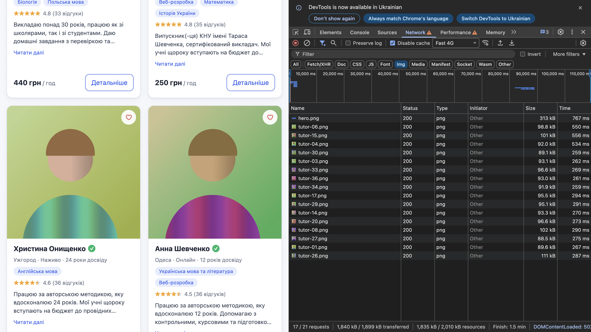

**Висновок:**

У результаті було зменшено розмір зображень і додано відкладене завантаження фотографій репетиторів. Це дозволило скоротити обсяг даних, які передаються під час завантаження сторінки, та уникнути одночасного завантаження всіх фотографій, які ще не переглядає користувач.


## Проблема 3. Надмірні обчислення Layout

**Виправлення:**

У файлі `src/hooks/useBioClamp.js` хук `useLayoutEffect` замінено на `useEffect`. До цього вимірювання висоти текстових блоків (`offsetHeight`, `getBoundingClientRect()`) та зміни класів елементів виконувалися до відображення кадру, затримуючи рендеринг сторінки. `useEffect` дозволяє браузеру спочатку відобразити сторінку, а потім виконати ці операції. Інша логіка роботи хуку залишилася без змін.

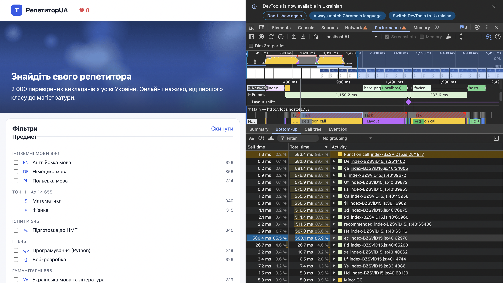

**Результат:**

Після заміни повторне вимірювання в Performance показало зменшення часу виконання приблизно з 2 секунд до 375 мс. Відповідна операція більше не виділяється як значний Long Task, що свідчить про зменшення блокування початкового відображення сторінки.


## Проблема 4. Повторне обчислення рейтингу репетиторів під час пошуку

**Виправлення:**

У файлі `src/utils/catalog.js` змінено функцію `getVisibleTutors()`. Раніше під час сортування за рекомендаціями компаратор повторно викликав `tutorScore()` для репетиторів, що призводило до повторного розрахунку зваженого рейтингу на основі відгуків при кожному порівнянні. Для оптимізації рейтинг кожного репетитора тепер обчислюється один раз перед сортуванням і зберігається в `Map`. Під час сортування використовуються вже розраховані значення, що дозволяє уникнути повторних обчислень без зміни формули рейтингу та логіки пошуку.

**Результат:**

Після внесення змін перевірено роботу пошуку та сортування за рекомендаціями й іншими параметрами. Список репетиторів коректно оновлюється, функціональність застосунку збережена. Оптимізація зменшує кількість повторних розрахунків рейтингу під час сортування.

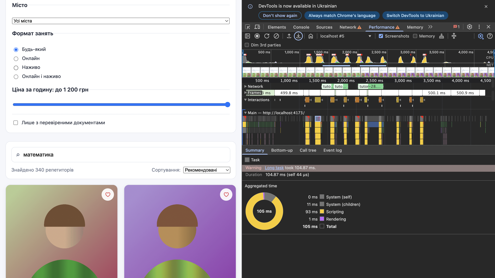


## Проблема 5. Повторне обчислення рейтингу репетиторів під час відкриття картки

**Виправлення:**

Окремих змін для вирішення цієї проблеми не вносилося. Під час оптимізації сортування каталогу в межах проблеми 4 було змінено логіку розрахунку рейтингів репетиторів. Раніше рейтинг повторно обчислювався під час кожного порівняння в процесі сортування, що створювало додаткове навантаження при повторному рендерингу каталогу, зокрема під час відкриття картки репетитора. Після оптимізації рейтинг кожного репетитора обчислюється один раз і використовується під час сортування, що також зменшило навантаження при відкритті картки.

**Результат:**

Після внесення змін повторно перевірено відкриття карток репетиторів за допомогою Performance. Взаємодія працює швидко, а час виконання функцій, пов'язаних із сортуванням каталогу, значно зменшився. Таким чином, оптимізація, виконана під час вирішення проблеми 4, також усунула затримку, що спостерігалася при відкритті картки репетитора, тому додаткових змін для цієї проблеми не потребувалося.

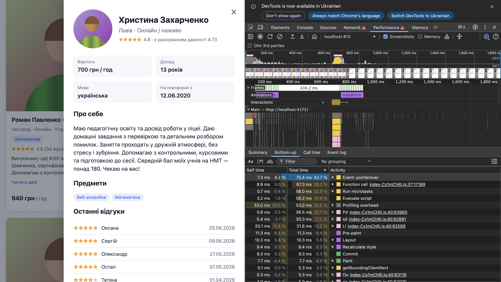


## Тестування

Для перевірки виправлення проблеми з великою кількістю DOM-елементів було написано тест `Pagination.test.jsx`. Він перевіряє, що на сторінці відображається не більше 20 карток репетиторів одночасно.

Спочатку тест було запущено на початковій версії застосунку, де пагінація ще не була реалізована. Тест не пройшов, оскільки замість очікуваних 20 карток відображалися всі 2000 репетиторів.

Після внесення змін тест було запущено повторно на виправленій версії застосунку. Цього разу він пройшов успішно, оскільки кількість карток на сторінці обмежена 20.

Таким чином, тест підтвердив, що внесене виправлення працює та обмежує кількість карток, які відображаються одночасно.

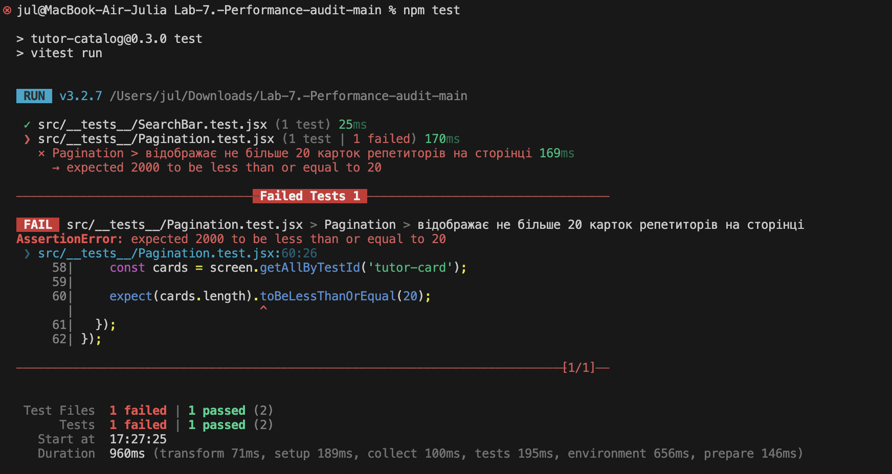

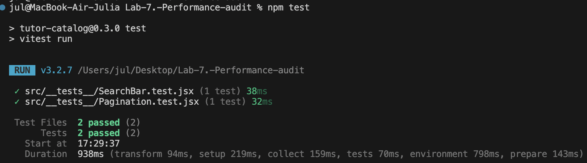